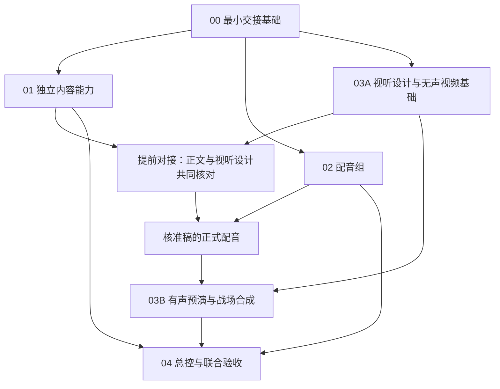

# 故事与动画 Skill 集合：实施计划入口

日期：2026-10-12。状态：内容规则已改并安装，声画效果验收尚未全部完成；此前00—04入口与第一版代码已建立，Remotion 已安装，正式片及一条85.248秒“真实配音+故事+战场地图”联合示例均已渲染。关键帧、媒体流解码、播放器连续播放、三类隔离修改恢复及配音中断后的部分缓存恢复均有记录；正式片和联合示例的真人听查、用户接受反馈仍未完成；各包准确边界以实施记录为准。

产品目标与约束见[快速成型计划](../故事与动画Skill集合-快速成型计划.md)，问题来源见[审查记录](../故事与动画Skill集合-计划审查与完善建议.md)。本目录是后续实施的任务说明，是本次正式交付，不作为临时执行记录删除。

内容层当前按[通用底座与创作专项改造计划](../内容生成Skill-通用底座与创作专项改造计划.md)第15节重新构思，第14节为历史实施记录。用户已实际否定影院、食店两个样片；当前改的是通用故事推进、口播与专项讲法。下表保留前一版运行证据，旧正式片及上述样片均不能凭历史审稿与技术产物称内容已验收或只差用户接受。新建本期对照原始要求，旧包历史不倒写。

## 当前验收差距

| 包 | 已有实物与可确认事实 | 尚缺的完成证据 |
|---|---|---|
| 00 | 共享契约、解析/摘要、审核依据检查已用于本期 `prepare`；隔离副本验证正文、表达、构图/留白三类变更的下游失效范围 | 核心变更边界已验证；完整字段接口仍按实际消费者逐项扩展，不代表所有可选结构都有实证 |
| 01 | 按旧 `investigation-video` 参考规则完成本期研究、骨架、播讲稿与视听对接；独立审稿通过并记录当前摘要 | 声画意图后续若有实质变化仍需复核；听查与用户接受不属于文本审核 |
| 02 | 用户授权调用火山 TTS；11句均生成 WAV 与词级时间；隔离副本中只改一条表达后真实重配1句、复用其余10句；再注入第二句 HTTP 503，确认第一句缓存保留、旧完整 timing 保留为 previous、失败运行不发布新完整 timing | 真人听查仍缺证据；中断恢复由隔离副本模拟服务失败验证，不代表真实供应商故障现场 |
| 03 | Remotion依赖已安装；15秒无声故事/地图演示完成；正式片实测映射为2466帧/82.2秒，解码及QuickTime连续播放通过；另有85.248秒全虚构联合示例，独立审核通过，11句真实火山配音及词级时间与故事场景、战场地图同片渲染，H.264/AAC解码、地图关键帧和QuickTime连续播放均有记录；真实MP4片段与配音临时合成及两项拒绝规则也通过 | 联合示例与正式片的真人听查及用户接受未完成。正式题材非战争，战场仅用于明确标记的虚构技术演示 |
| 04 | 总控入口、六个本机链接、状态快照与正式一期已落地；隔离副本实测正文变更门控、表达局部重配、构图留白后重渲染及配音中断恢复，输入摘要均正确传播；正式片连续播放有当前MP4摘要记录 | 真人听查和用户接受反馈未确认 |

用户已指定懂车帝尊界 V800 制动争议为正式题材，并授权修改 `package.json`、安装 Remotion 依赖及运行配音、渲染和检查；旧项目已作为内容制作参考。本轮按用户要求将必要火山凭据复制为本机私有配置，权限为0600并由本仓库忽略；不在文档、输出或提交中保存密钥。上表各项仍以列明的实际证据为准；代码存在本身不代表整包验收通过。

## 1. 拆分决定

按共享规则、代码与验收依赖拆成五个包。Skill 可独立调用，不意味着它们必须独立开发；包内一起实施也不意味着每次生产都必须一起调用。

| 包 | 覆盖范围 | 为什么这样拆 | 可独立交付什么 | 成本与边界 |
|---|---|---|---|---|
| [00 最小交接基础](00-最小交接基础.md) | 输入格式、句段引用、审核依据、时间语义与共享读取能力 | 内容、配音、视频都会消费同一稿件与版本；先统一这些，才能分别实施 | 短交接约定、最小公共模块、明确标为格式示例的输入 | 只解决实际共享字段，不建立工作流引擎或全套 schema 平台 |
| [01 内容组](01-内容组实施.md) | story-plan + story-write + story-review | 三者共同定义什么该讲、正文如何实现、审核依据是什么；分别开发容易规则不一致 | 研究/骨架、播讲稿、独立审稿均可分别调用 | 包内职责清楚，不把三份 Skill 合成一个总控 |
| [02 配音组](02-配音组实施.md) | story-voice + TTS/缓存/源时间 | 只需稿件与有效授权依据，不应依赖 Remotion 或旧总控 | 有声稿、真实音频、源时间与听查结果 | 格式调通不代表真实 TTS 与听感通过 |
| [03 视频组](03-视频组与战场适配实施.md) | story-video + 视听设计 + Remotion + 战场适配 + 字幕合成 | 分镜、声音放置、字幕、战场片段共同使用最终时间轴，应有一个实现责任方 | 无声动画可先交付；声音齐备后交付有声片 | 内部分 A/B 两阶段，避免等待配音才开始设计，也不拆第二渲染器 |
| [04 总控与联合验收](04-总控与联合验收实施.md) | story-produce + 恢复/局部更新 + Skill 安装 + 完整一期 | 总控调用实际能力，需要以上各包的真实交付 | 按指定阶段停止/恢复的生产入口与联合验收记录 | 不重写各包业务规则，不把全部问题压到最后再发现 |

## 2. 实施顺序和对接时点

- 00 完成后，01、02、03A **可以分别实施**。只有获得分派时才启动并行执行；本次不创建实施任务或子代理。
- 02 可以用真实用户冻结稿或有效已审稿独立验证 TTS；只有格式示例时先完成读取、拒绝过期依据等部分，不伪造通过审核来调用正式 TTS。
- 03A 先实现视听设计、阅读视图和无声片，不等待真实音频。它与01用同一材料对齐“谁说、怎么说、画面交代什么”，这是提前对接点。
- 03B 可先用**明确标为模拟**的 timing 数据核对计算，但有声验收必须接入02的实际音频，且对应稿件已经完成提前对接和独立审核。
- 04 可以先写路由草案，最终路由与恢复能力须用已完成接口验收；完整一期在短片联合检查成立后进行。

默认只有一个实施者时：00 → 01的内容基础 → 03A → 01与03A提前对接 → 02真实配音 → 03B → 04。此顺序使视听意图进入稿件定稿过程，不要求先把所有 Skill 文档写完。

01与03A各自先交付可独立调用的能力，提前对接作为两方共同验收，不是彼此开始实施的前置。03B的地图绘制也可用明确标为演示的数据提前开发；等待02的只有真实声画接入与验收。这样既允许分别推进，也保留必要的联合检查。

开发顺序与每期生产顺序不同：Skills 开发完成后，一期有声视频仍按“研究 → 播讲稿与视听设计协作 → 审核 → 配音 → 预演 → 细化合成 → 交付”执行。

## 3. 文件责任与共享变更

实施目标根目录为 `/Users/jack/Documents/codes/lvgou/ai-video/story-studio/`；现已创建。下表是各包的文件责任。

| 唯一负责包 | 主要文件范围 | 其他包如何使用 |
|---|---|---|
| 00 | `references/handoff.md`、`runtime/shared/content-contract.mjs`、`examples/contracts/`、初始 `README.md` | 读取/导入共享约定；不得各自另写正文提取或摘要算法 |
| 01 | `skills/story-plan/`、`skills/story-write/`、`skills/story-review/` | 02消费有效稿件与审核；03消费骨架/正文并反馈视觉意图 |
| 02 | `skills/story-voice/`、`runtime/voice/` | 03消费源音频及 timing，不在音频文件中嵌入全片剪辑偏移 |
| 03 | `skills/story-video/`、`runtime/remotion/`、本期 `visual/` | 01读取分镜内容依据；04调用已实现的预演/渲染能力 |
| 04 | `skills/story-produce/`、最终集合 `README.md`、安装说明/技能链接、本期联合验收记录 | 只组织调用与状态，不复制审核、配音或时间映射实现 |

00 的共享模块后续变更由当前集成责任人统一修改，同时列明受影响的01/02/03消费者。并行实施者先在各自交付中说明需要变更的字段和原因，不能静默创建互不兼容的格式。语义变更先更新 handoff 与实例，再修改相关生产者和消费者；单纯增加本包内部字段不扩张共享接口。

所有包的阶段记录写入本包计划末尾“实施交接记录”；本期制作记录写入 `<episode>/episode.md`。只有00起步和04收尾编辑集合 README；中间包在自身说明中保留准确命令，由04汇总，减少共享文件冲突。

## 4. 阅读与执行规则

实施者先读本入口、本包计划、总计划中本包标出的章节、已完成的 handoff；再读本包列出的直接源码。无需每次通读全部旧 Skill。当前用户要求优先；总计划规定产品目标，本目录细化实施步骤，handoff 记录已落地接口。

每个包只在其授权范围内实施。依赖安装、修改 package.json、测试、lint、dev server 和真实制作调用遵循当次用户要求及项目规则；下文列出的是未来验收方法，不自动扩大授权。没有授权的检查记录“未执行”，不常规追问。必要检查无法进行时可交付完成部分，但不能标记整个包已验收。

计划制定阶段只制作计划文档；后续已按用户的执行指令开始实施。当前项目仍限制未经明确要求的测试、安装与运行检查。若后续明确要求测试，纯逻辑部分使用必要的针对性检查；听感、动作、画面理解必须依靠实际媒体检查。每次交付区分“文件已写、静态核对、真实调用、听查/播放、用户认可”。

## 5. 计划制定时的事实与待解事项

| 事项 | 本轮依据 | 对实施的影响 |
|---|---|---|
| 新集合尚未创建 | 当前项目只有主计划与审查文档；本次新增本目录 | 所有拟建命令与文件都不能当成已有能力 |
| 旧 TTS 底层有可选复用点 | `tts.mjs` 引用 content-cache，调用 FFmpeg/ffprobe；`tts-s20.mjs` 绑定旧审核、日志、切句脚本和脚本目录输出 | 02迁出底层并适配新格式，不能复制旧总入口 |
| 地图组件绑定演示数据 | `index-v2.jsx` 导入 regions 与 map-data；地图 README 明示现代日本边界/虚构战场 | 03拆出本期数据入口与场景，保留专项规则，正式历史不能直接沿用数据 |
| 旧渲染脚本含个人浏览器路径 | 旧模板 package.json 中的 render/still 命令 | 03用明确配置定位浏览器，不复制原命令 |
| 迁都样片源码和 runtime.mjs 未找到 | 总计划已记录；本轮未发现新的可用位置 | 不列为实施前置；首个叙事场景重新实现 |
| 音频凭据、浏览器运行、实际听查能力未验证 | 本轮未读取密钥或运行服务 | 02/03按各自前置核实；缺项只阻塞依赖该能力的工作 |
| 正式题材与完整一期范围尚未指定 | 当前任务是实施计划 | 用明确标为演示的短材料验证格式；正式内容沿用后续用户决定，不擅自编造冻结授权 |

## 6. 本次计划文档验收

本次任务清单和验收标准已写入总计划的“实施计划拆分记录”。交付前核对：包与 Skill 覆盖一一对应；文件责任无重复；开发依赖无环；内容与视听设计提前对接；每包有输入、步骤、输出、验收和阻碍处理；相对链接可打开。

当前实施状态：00共享逻辑已被正式稿件准备流程调用；隔离副本确认正文变化让审核/配音过期、表达变化只让配音过期、构图留白只让视觉预演过期；01真实题材材料、正文与视听对接及独立审核完成；02真实TTS生成11句音频与词级时间，表达修改实测重配1句并复用10句，真人听查待完成；03演示与82.2秒有声成片已渲染，代表帧检查及完整媒体流解码通过；04已在隔离副本完成三类文件级恢复，其中构图留白副本重渲染成功。正式片连续播放已在QuickTime完成并绑定当前MP4摘要；虚构地图演示与真实外部视频片段的运行检查已补齐；同一短片内真实口播+故事+战场地图的专项组合已完成虚构技术演示：独立审核通过、11句真实TTS和词级时间、85.248秒H.264/AAC渲染、全片解码与QuickTime连续播放均有当前MP4证据；配音真人听查和用户接受仍待完成；真人听查和用户接受反馈仍待完成。下文“本轮”均指计划制定阶段的历史记录。

本轮文档核对结果：五个包覆盖六个新 Skill 与战争专项，逐项责任已落实；流程图与前置条件已复核，联合检查不构成开发循环；六份新文档的本地链接和代码围栏已核对。本轮未实施 runtime、未安装依赖、未调用配音或渲染。
