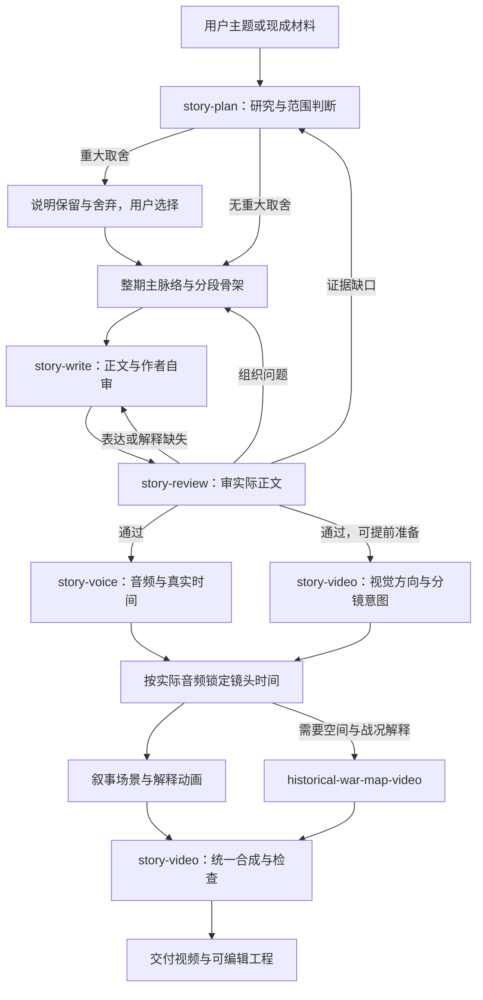

# 故事与动画 Skill 集合：快速成型计划

日期：2026-10-11。状态：规划与参考调研完成；尚未实施新 Skill 集合。

## 1. 本轮决定与目标

建立一套可以分别调用、也可以连续生产的 Skills：从主题与材料开始，完成故事构思、口播正文、文本审核、配音、对应动画和完整视频。

用户明确决定：现有 investigation-video 作为内容生产的经验与参考来源；旧视频层不作为新架构基础。新视频路线采用 Remotion + React + SVG 代码动画，配合专门的历史战场 Skill。当前优先快速成型。

因此采用**新集合、新入口、一个动画运行环境**。从旧系统筛选内容规则和可用工具；不要求新系统依赖旧总控、旧视觉预设、旧镜头配置或旧工程格式。旧文件与已有工程保留，本计划不安排重写或迁移它们。

第一版定位为知识类口播动画：能讲人物、事件、历史过程和反直觉问题，能以动画解释行动、关系和结果。第一版不承诺电影级人物表演、连续打斗、自动生成所有历史美术或无人参与的质量保证。

## 2. 已核实的起点及实际缺口

| 起点 | 本轮证据 | 可以继承什么 | 不能据此认定什么 |
|---|---|---|---|
| 旧内容流程 | [Skill 入口](/Users/jack/Documents/codes/lvgou/ai-video/skills/investigation-video/SKILL.md)、[内容规则](/Users/jack/Documents/codes/lvgou/ai-video/skills/investigation-video/references/content-generation.md) | 材料索引、体量判断、mainNarrative、段落任务、写作回查、定位正文的审核方法 | 旧规则全部必要，或只要遵守就能稳定产出好内容 |
| 故事策划 | [story-planner](/Users/jack/Documents/codes/lvgou/ai-video/skills/story-planner/SKILL.md) | 材料优先、按内容组织、阶段可单独交付 | 与新策划 Skill 同时争夺生产入口 |
| 配音底层 | [tts.mjs](/Users/jack/Documents/codes/lvgou/ai-video/skills/investigation-video/scripts/tts.mjs)、[tts-s20.mjs](/Users/jack/Documents/codes/lvgou/ai-video/skills/investigation-video/scripts/tts-s20.mjs) | 火山接口、现有音色参数、缓存、真实时长和时间戳处理 | 旧入口可直接独立使用：它绑定旧规则路径、审核格式与日志 |
| 叙事动画试作 | [迁都样片源码](/Users/jack/Documents/codes/lvgou/ai-video/work/animation-demo-20261011-xiaowen/index.jsx) | Remotion 中直接画 SVG、按帧控制画面、渲染和抽帧的技术路径 | 这是成熟角色动画系统；或样片已获用户审美认可 |
| 战场能力 | [战争地图 Skill](/Users/jack/Documents/codes/lvgou/ai-video/map-demo/skills/historical-war-map-video/SKILL.md)、[地图工程说明](/Users/jack/Documents/codes/lvgou/ai-video/map-demo/README.md) | 地形、部署、路线、阵营与镜头的组织方法；SVG 和地形生成实现参考 | 日本演示数据适用于中国历史；虚构地形可以当真实战场；已完成完整播放验收 |

本轮只是读文件、查依赖和上网调研，没有重新调用 TTS 或渲染。此前 18 秒样片的渲染与抽帧记录证明短片制作可行，不证明长视频、语音与战场混合编排已经打通。

## 3. 第一版 Skill 分工

六个新入口加一个已有专项 Skill。名称暂定，职责在实施前固定；不另拆研究、骨架审核、正文审核、字幕、混音和封面为独立 Skills。

| Skill | 独立调用时做什么 | 最小输入 | 交付 | 责任边界 |
|---|---|---|---|---|
| `story-produce` | 连续制作或从指定阶段恢复 | 本轮目标、停止位置、已有产物 | 产物链接与本期入口更新 | 路由、检查前置输入、记录交接；不重复定义写作和动画规则 |
| `story-plan` | 研究材料、构思故事、判断范围；需要时规划系列分集 | 主题或材料、受众、内容要求 | 来源索引、整期主脉络、分段骨架 | 研究与构思在一个工作上下文中完成；重大聚焦/分期选择才询问 |
| `story-write` | 将骨架写成可播讲正文，或修改用户稿 | 当前骨架、相关来源、表达要求 | 口播稿与简短作者自审 | 对关键资料缺口回查；不为了好写擅改整期范围 |
| `story-review` | 单独审构思、骨架或正文 | 实际待审内容、目标、相关材料 | 定位到原文的缺陷、依据和通过/需修订结论 | 同一个 Skill 按对象审查；不以概述替正文补解释，不默认重写全文 |
| `story-voice` | 将有效文本生成音频，提供真实时间依据 | 稿件、审核依据或明确的用户冻结决定、声音设置 | 音频、段落/句子/逐字时间信息 | 沿用当前声线与原速；不替用户判断主观听感 |
| `story-video` | 设计分镜、制作叙事动画、组装战场镜头、加字幕并导出 | 正文、音频时间、资料与视觉要求 | 分镜、可编辑工程、动画片段或整片、检查记录 | 同时负责画面导演和最终合成，第一版不再拆三个调度层 |
| `historical-war-map-video` | 单独制作有明确空间含义的战场镜头 | 年代、地形/位置/路线依据、事件顺序、画面时长 | 战场场景组件或约定规格的视频片段 | 只负责空间与战况表达；由 story-video 组装，普通叙事不必调用 |

独立使用不要求从头走流程。只有稿件时可以写作或审核；只要动画时可以提供文字和镜头时长，不强制先配音；要有声成片时，最终镜头时间必须来自实际音频。

新制作调用新入口。旧 investigation-video、story-planner 作为实现参考保留，不能在每期生产时把新旧规则全文一起读取。

## 4. 整体流程和必要返回



骨架可以单独交付给用户或调用 story-review 审查，但不新增每期必过的独立骨架审核门。完整生产仍在正式配音前完成正文审核。

发现盲区时只补能影响当前判断的材料，补完回到原段落；不重新研究整个主题。修改上游后标记受影响的下游产物过期，禁止用旧通过记录放行新稿。

## 5. 内容能力如何借鉴旧系统

| 保留的方法 | 新集合中的位置 | 简化与边界 |
|---|---|---|
| 可靠材料、来源位置、重要边界 | story-plan 的材料记录 | 总览加按需拆分的来源正文，不重复建立知识库与来源台账 |
| 初研后判断内容体量 | story-plan | 只有明显改变主内容、方向或分期才询问；几分钟到十几分钟是参考，不是强制裁切 |
| mainNarrative 与分段任务 | story-plan → story-write | 一段连贯文字说明整期发生什么、如何变化、结果是什么；各段再安排必要材料 |
| 重要关系、行动依据、结果展开 | story-write | 检查遗漏是否导致观众误解人物选择与结果；不固定人物数量或每段必须有反转 |
| 根据材料选择讲法 | story-plan 与 story-write | 事件叙述、机制解释、对照等按任务使用；后台研究问题不自动写成口播问句 |
| 实际文本审核 | story-review | 以是否讲清、是否兑现、是否有依据为重点；不增加评分和审核层级 |
| 用户样本库 | 集合参考目录 | 只有用户选入的内容才是优秀参考；生成记录、日志、测试片不自动晋升为范文 |

不把旧审核 JSON 的全部字段和周期机制当作新需求。新审核至少绑定实际稿件、骨架、要求、使用的来源及审核规则版本，记录具体缺陷位置；程序只检查版本和交接，不宣称能自动判断故事好不好。用户明确冻结外部稿件时记录实际决定，不伪造 AI 审核。

故事策划支持历史事实叙述和用户明确要求的虚构创作；历史任务不补造人物心理和动机。系列策划先用一份系列 Markdown 记录系列承诺、分集边界、已讲背景与待讲内容，不先开发排期系统或跨期数据库。

## 6. 新视频层的具体方向

**主技术固定为 Remotion + React + SVG。** 一期按内容需要组合叙事场景、关系/机制图解和战场动画。第一版不再接入旧 ConfiguredVideo、旧 video-presets 或旧镜头类型登记体系。

每个场景是一个可独立渲染的 React 组件，接收实际片段时长、需要表达的内容和必要视觉参数。动画按帧号计算，不依赖真实时钟、随机运行顺序或 CSS 自播放。官方也要求以 useCurrentFrame 驱动动画，以避免渲染中的闪烁与不确定性。[Remotion 动画说明](https://www.remotion.dev/docs/animating-properties)

| 画面任务 | 第一版表现 | 验收重点 |
|---|---|---|
| 人物做出选择、传令、出发、会见、物资转移 | 分层人物、道具、场景与镜头；简单关节动作/姿态切换 | 观众能识别谁做了什么、前后发生什么变化；不能只有整张图平移 |
| 势力关系、制度变化、人物分歧 | 关系线、位置变化、关键物件和少量文字 | 画面使关系更清楚，不能用一屏文字替代解释 |
| 战争推进、地形限制、部署与撤退 | 战争地图 Skill 的大/小地图表现 | 地形与路线有依据，军团与轨迹一致，结果能看懂 |
| 段落连接与时间推进 | 镜头切换、场景延续、必要的时间标识 | 保留人物和地点识别线索，避免每句重置场景 |

当前迁都样片可以复用技术手法，不能把车队、城门、红日、雪山和同一种人物自动复用到每个历史题材。浮世绘也是可选视觉参考；中国历史的服饰、建筑、道具和地理不因画风选择而变成日本元素。

分镜用一句话写清“这个镜头开始是什么状态、发生什么、最后变成什么”，再列涉及的旁白段落、素材/史实依据与时长。比如稿件说进入城门，画面就要明确出现进入后的状态；只把车队移到门前不能视为完成。示意动作与真实历史动作的证据要求分开。

为快速成型，首片先建立确实会重复使用的少量角色、场景和动作组件。不要先做人物生成器、万能场景 schema、自动编剧引擎或大规模动作库。角色表情、复杂动作确实超出代码图形能力时，再用用户选定的图像素材/生成分层图补足。

## 7. 技术与工具清单

“首版使用”是规划决定；“已有”不等于新集合中已验证。

| 技术/工具 | 用途 | 当前证据/入口 | 第一版决定 |
|---|---|---|---|
| Codex 与 Markdown Skills | 执行各阶段、按需读取规则 | 当前工作环境 | 一个主任务可顺序执行；独立审查按需使用独立上下文，不建多代理调度系统 |
| AnySearch | 定向搜集史料与官方资料 | [本地 Skill](/Users/jack/.agents/skills/anysearch/SKILL.md)；本轮 batch_search 成功 | 默认检索工具；备用网页搜索沿用用户已有授权 |
| Node.js | 脚本、TTS、渲染入口 | 旧工程要求 ≥20.12；此前本机为 24.11.1 | 使用本机已配置运行时，实施时检查实际版本 |
| Remotion 4.0.508 + React 19.2.8 | 场景、逐帧动画、时间线与 MP4 渲染 | [现有 package.json](/Users/jack/Documents/codes/lvgou/ai-video/skills/investigation-video/template/remotion/package.json) | 新运行环境沿用这组可用版本；不为获取新功能先升级 |
| SVG / JSX | 人物、道具、路径、地图与关系图 | [叙事样片](/Users/jack/Documents/codes/lvgou/ai-video/work/animation-demo-20261011-xiaowen/index.jsx)、[地图组件](/Users/jack/Documents/codes/lvgou/ai-video/map-demo/index-v2.jsx) | 主绘制方式；普通场景直接写组件 |
| Chromium | Remotion 帧渲染 | 此前使用本机 Playwright Chromium 缓存 | 提供可配置 browserExecutable；不硬编码个人缓存路径、不自动下载 |
| FFmpeg / ffprobe | 音轨处理、合成辅助、抽帧、格式与时长检查 | 本机已有，样片曾实际使用 | 首版使用；抽帧不代替连续动作检查 |
| 火山/豆包 TTS | 中文旁白与时间戳 | [tts.mjs](/Users/jack/Documents/codes/lvgou/ai-video/skills/investigation-video/scripts/tts.mjs) | 迁出必要底层及缓存依赖；保留渊博小叔与原速，不同时试新声线 |
| Python + Pillow/numpy | 战场地形图片与图像辅助 | [地形脚本](/Users/jack/Documents/codes/lvgou/ai-video/map-demo/build-terrain.py) | 仅相关任务使用；当前虚构地形不能用于正式地理结论 |
| GeoJSON 与有来源的历史地图/地形数据 | 战场空间依据 | [地图数据入口](/Users/jack/Documents/codes/lvgou/ai-video/map-demo/map-data.mjs) | 逐题核实；现代行政边界不得当古代疆界 |
| yt-dlp | 下载明确给出的视频来源 | [下载脚本](/Users/jack/Documents/codes/lvgou/ai-video/skills/investigation-video/scripts/download-source.mjs) | 研究参考时按需复用，不作为新视频视觉素材主线；平台可用性逐次验证 |
| 豆包 ASR / 可选本地 Whisper | 参考视频转写 | [转写工具说明](/Users/jack/Documents/codes/lvgou/ai-video/tools/extract-audio-content/README.md) | 按需，正式 TTS 有有效时间戳时不重复 ASR |
| imagegen | 复杂角色、背景和分层素材 | [本地 Skill](/Users/jack/.codex/skills/.system/imagegen/SKILL.md) | 可选，不成为第一条纯代码样片的必需服务 |
| Git、文件摘要 | 代码维护、内容版本与失效检查 | 现有仓库和 Node crypto | 使用已有能力，不加数据库或向量系统 |

旧 TTS 的可复用部分也有依赖：[runtime.mjs](/Users/jack/Documents/codes/lvgou/ai-video/skills/investigation-video/scripts/lib/runtime.mjs)、[content-cache.mjs](/Users/jack/Documents/codes/lvgou/ai-video/skills/investigation-video/scripts/lib/content-cache.mjs)。实施时一起审计迁入新 runtime/voice，不能只复制一个函数就宣称独立。旧 tts-s20 的审核、日志、opening 约束不整段带入新集合。

## 8. 可参考或纳入的 Skill 登记表（含链接）

本地链接表示入口文件存在；外部链接表示本轮查阅官方资料，不表示已经安装或运行。这里是选型登记，不是每期必读清单。

| Skill / 项目 | 对应环节 | 借鉴或使用方式 | 第一版取舍 | 可点击入口与证据状态 |
|---|---|---|---|---|
| investigation-video | 内容全流程经验 | 抽取主脉络、材料回查、正文审核的有效要求 | 参考；旧视频层不接入 | [本地 Skill](/Users/jack/Documents/codes/lvgou/ai-video/skills/investigation-video/SKILL.md)，本轮核对 |
| story-planner | 研究与故事构思 | 材料优先、结构与交付范围 | 参考到新 story-plan，避免双入口并用 | [本地 Skill](/Users/jack/Documents/codes/lvgou/ai-video/skills/story-planner/SKILL.md)，本轮读取 |
| historical-war-map-video | 战场专项 | 地形、军团、路线、战略/战术切换 | 纳入，适配新镜头接口 | [本地 Skill](/Users/jack/Documents/codes/lvgou/ai-video/map-demo/skills/historical-war-map-video/SKILL.md)，本轮读取 |
| Remotion 官方 Skills | 动画实现与渲染 | markup/render/captions/maps 等按任务读取 | 优先选入的外部技术参考；安装属于实施阶段 | [官方仓库](https://github.com/remotion-dev/skills)、[官方说明](https://www.remotion.dev/docs/ai/skills)，本轮核实；具体规则需匹配本地版本 |
| huashu-art-motion | 画面设计与动作组织 | 风格配方、先定关键帧、再组织场景动作 | 借鉴方法，不整套替换主引擎、不把运动量门禁当审美标准 | [官方仓库](https://github.com/alchaincyf/huashu-art-motion)，本轮查阅；未安装验证 |
| narrative-core | 用户参考视频的分析 | 提取可迁移的叙事机制，避免固化案例桥段 | 分析用户样本时可选 | [本地 Skill](/Users/jack/.agents/skills/narrative-core/SKILL.md)，入口存在，本轮未审计效果 |
| novel-distill | 人物与事件材料梳理 | 从有依据的材料提取行动、约束和结果 | 复杂事件按需用，不强制每期调用 | [本地 Skill](/Users/jack/.codex/skills/novel-distill/SKILL.md)，入口存在，需按历史事实任务约束使用 |
| dbs-good-question | 模糊任务澄清 | 将模糊需求变成可研究的具体任务 | 仅输入不清时用；不把问题模板写进口播 | [本地 Skill](/Users/jack/.codex/skills/dbs-good-question/SKILL.md)，入口存在，本轮未运行 |
| imagegen | 美术资产 | 生成背景、角色姿态、透明素材，代码组织动作 | 按需补充 | [本地 Skill](/Users/jack/.codex/skills/.system/imagegen/SKILL.md)，可用能力，本轮未生成 |
| HyperFrames | HTML 动画的另一条实现路线 | 参考其路由与按需加载方式 | 暂不引入第二套主渲染器 | [官方仓库](https://github.com/heygen-com/hyperframes)，本轮核实支持 HTML/CSS 到确定性 MP4 |
| Hypit | 更大范围的媒体制作编排 | 参考脚本、素材和组合的责任划分 | 暂不纳入主链，避免再接一套运行体系 | [本地 Skill](/Users/jack/.codex/skills/hypit/SKILL.md)，此前读取，当前样片未使用 |
| video-use | 已有录制素材的剪辑 | 将来有大量口播/采访素材时再评估 | 当前纯动画主线不必加入 | [本地 Skill](/Users/jack/.codex/skills/video-use/SKILL.md)，入口存在，非本轮运行验证 |
| manim-video | 数理与技术图解 | 数学/科学题材可单独输出片段 | 历史首版暂缓 | [本地 Skill](/Users/jack/.codex/skills/video-use/skills/manim-video/SKILL.md)，入口存在，非本轮效果验证 |
| writing-prompt | 集合设计与维护 | 条件、操作、输出、失败去向及按需读取 | 设计阶段使用，不是每期生产前置 | [本地 Skill](/Users/jack/.agents/skills/writing-prompt/SKILL.md)，本轮读取 |
| rethink / brainstorming | 方案讨论 | 检查假设和画面方向 | 用户需要构思时使用，不叠加为每期固定门槛 | [rethink](/Users/jack/.agents/skills/rethink/SKILL.md)、[brainstorming](/Users/jack/.codex/skills/brainstorming/SKILL.md)，本会话读取过 |

官方 Remotion 仓库已按创建、动画标记、渲染、地图、字幕等划分参考入口；可以借鉴按需加载，不需要每个入口再包装成自己的 Skill。Huashu 提供独立的风格/解说动画方法及工具链，接入代码前需逐项适配，不能假定它的组件能直接导入 React 工程。

外部样片只作为研究参考，不自动加入用户的优秀样本库。复制第三方代码或素材时保留相应许可；例如 Huashu 的作者角色资产不随代码的 MIT 许可开放使用。

## 9. 额外技术调研与头脑风暴取舍

| 技术与链接 | 官方说明能支持什么 | 对当前任务的价值 | 当前决定 |
|---|---|---|---|
| [Motion Canvas](https://motioncanvas.io/) | TypeScript 动画及网页编辑器，辅助与音频对齐 | 可参考按事件组织连续动画、按音频安排动作的方法 | 保留参考；首版使用它会增加第二套动画执行模型 |
| [Theatre.js](https://www.theatrejs.com/) | 浏览器中的关键帧、曲线编辑和 JS 动画变量控制 | 用户将来需要直接拖动调整镜头与动作时有价值 | 暂缓，当前先解决 Agent 能生成可看的片段 |
| [HyperFrames](https://github.com/heygen-com/hyperframes) | HTML、CSS、媒体与可定位动画渲染为 MP4，并提供 Agent Skills | 是完整替代路线，可比较开发方式 | 不与 Remotion 同时建设主链，避免工具数量代替产出 |

调研后的优先级：Remotion 官方规则 → 本地战场专项 → Huashu 的画面方法 → 必要时 imagegen。没有发现必须立即再加一种渲染技术才能完成第一版的证据。

最快改善视觉的方法是先做一段有真实动作结果的代表性场景，再把其中可复用的代码整理出来。增加风格数量、换渲染器、提高运动量，都不能单独证明动画更好。

## 10. 目录与最小交接

建议新集合根目录：`/Users/jack/Documents/codes/lvgou/ai-video/story-studio/`。这是拟建位置，本轮未创建。

```text
story-studio/
├── README.md                     集合地图、入口与命令
├── skills/
│   ├── story-produce/SKILL.md
│   ├── story-plan/SKILL.md
│   ├── story-write/SKILL.md
│   ├── story-review/SKILL.md
│   ├── story-voice/SKILL.md
│   └── story-video/SKILL.md
├── references/
│   └── handoff.md                共享交接规则只定义一次
├── runtime/
│   ├── voice/                    TTS、缓存与时间信息
│   └── remotion/                 同一引擎、动画与地图组件、总片入口
└── samples/                      仅用户选入的参考；不预置生成记录
```

战争 Skill 首版明确引用现有绝对路径，以本期新地图数据和新 runtime 入口工作，不默认执行旧 map-demo/render.sh。待有实际维护需要再迁移它，避免同时出现两个同名规则源。

各新 Skill 在本机技能目录分别建立链接到真实目录，不假定扫描器自动识别嵌套子目录。运行代码安装于集合中一处，单独调用某个 Skill 时也能定位这处运行环境。

一期工程采用以下简单约定：

```text
<episode>/
├── episode.md          当前目标、有效版本、完成到哪、下一步
├── research/           来源索引和必要原文
├── outline.md          mainNarrative、段落任务、关键材料
├── script.md           稳定段落/句子 ID 与正文
├── review.json         实际结论、问题位置、审核输入摘要
├── audio/              音频、timing.json 与缓存引用
├── visual/
│   ├── shots.json      分镜意图与最终镜头时间的唯一表
│   ├── scenes/         本期 JSX 场景
│   └── assets/         本期素材、地图数据及来源说明
└── output/             成片与简短交付记录
```

实施时定义最小字段即可，不另发明多套 plan/resolved/manifest 状态：

- `timing.json`：关联实际稿件摘要、音频位置、段落/句子 ID 与秒数；字幕有逐字数据则保留。时间来自实际音频，不能把估算写成测量。
- `shots.json`：每镜 ID、关联段落、意图、开始/结束状态、场景入口、起始帧/帧数、资源引用；配音前允许时间待定，渲染前必须完整。
- 正式有声片默认 30fps、16:9，预览 720p，正式导出以项目要求为准；采用统一 `round(seconds × fps)` 时间边界换算，相邻镜头共享边界，避免分别取整积累误差。
- 场景组件按自己的局部帧运行；最终组合负责分段偏移、字幕、音轨和总时长。优先直接复用场景组件；独立 MP4 接入时核对帧率、分辨率、时长和是否带音轨。
- 下游读取当前输入摘要；稿件变了，旧审核和音频标记过期；仅动画变了，不重生成口播和音频。第一版按实际受影响文件失效，不开发通用依赖图引擎。

## 11. 按依赖排序的实施计划

所有新路径以下均相对拟建的 story-studio/。旧文件是参考位置，不是本轮修改目标。

| 顺序 | 工作与具体做法 | 文件/依赖 | 验收方法 | 成本与可能负收益 |
|---|---|---|---|---|
| 1 | 建立集合入口和唯一交接约定；确定六个入口、战争 Skill 引用、停止阶段和当前版本定位 | `README.md`、`references/handoff.md`、六个 `skills/*/SKILL.md` | 给现成稿只审稿、给音频只做画面、只要骨架就停止，路由无重复职责 | 文档必须短；不复制旧全文，不把全部参考列为必读 |
| 2 | 将材料、范围、mainNarrative、关键解释与正文审核经验重写到各自入口/必要引用中 | `skills/story-plan/`、`story-write/`、`story-review/` | 同一真实材料能形成连贯骨架；故意遗漏关键原因的正文被定位，不能因骨架完整而通过 | 精简不能删掉事实边界；问题式叙事不能成为全局默认 |
| 3 | 从旧 TTS 迁入合成、缓存和时间信息底层；新入口只适配新审核与稿件契约 | `runtime/voice/`、`skills/story-voice/`；核对旧 tts.mjs 及必要依赖 | 短稿出音频与真实时间；改稿后拒用旧审核；纯视觉修改复用同一音频；参数和缓存对应实际输入 | 这是有代码成本的解耦；禁止以绕过审核缩短实施 |
| 4 | 建立一个 Remotion 运行环境；提供场景入口、字体、帧动画、渲染与抽帧命令 | `runtime/remotion/`、`skills/story-video/` | 在显式指定本机浏览器情况下独立渲染一个场景；无个人绝对缓存依赖，无隐式下载 | 必要依赖只一份；不先造风格引擎或通用动作 DSL |
| 5 | 适配一个故事场景和一个战场场景；形成分镜意图到组件的操作规范 | `visual/scenes/`、`runtime/remotion/` 中实际重复部分；现有战争 Skill | 故事场景能看见动作结果；战场能看出谁在哪、沿何路、因何地形限制；不同镜头人物/阵营识别一致 | 首片简单动作即可；不要承诺复杂表演，不能复用旧虚构地图冒充本期资料 |
| 6 | 完成音频、时间戳、镜头、字幕和最终导出的组合 | `runtime/remotion/` 总片入口、`timing.json`/`shots.json` 读取 | 片段边界无时间累计误差、最后一句完整、字幕可读、无意外静音/黑帧；失败时返回具体输入或场景 | 字幕/画面冲突要实际检查；不能只通过格式校验 |
| 7 | 完成一次短链路试片，再扩展到一条几分钟的完整内容 | 独立本期工程，不动历史产物 | 先用约 60–90 秒覆盖故事动画+地图+旁白；之后用用户确定范围的完整一期检验长片内容与节奏 | 短片时长只是测试预算，不写入生产硬规则；完整片做完才判断可进入常规生产 |
| 8 | 根据实际复用点整理少量组件，登记已验证能力和剩余缺口，安装各 Skill 链接 | 集合 README、各入口及已有 runtime | 单独调用、串联调用、恢复任务三种路径能使用同一套产物 | 不为“收尾”追加样式、引擎、自动发布和历史迁移 |

实施授权后，优先打通 1→2→3→4→5→6→短试片。第一版不以完成所有候选工具研究为前置，也不以搭建美术资产平台为前置。每个阶段交付可检查产物，避免用“先把全部 Skill 写完”代替运行链路。

## 12. 快速成型的限制与完成标准

第一版先做：来源与故事、清楚的稿件、一次独立正文审核、当前配音、少量叙事场景、按需战场、统一字幕和成片。

暂缓：自动搜集优秀样本、历史工程迁移、旧视觉兼容、大规模多画风、3D 战场、自动口型、复杂骨骼、第二渲染器、知识库产品、评分系统、自动发布、跨平台运营后台。配乐按需，不影响第一条故事链路验收。

完成必须同时满足：

1. 各 Skill 能在输入齐备时独立工作，并能在用户要求的位置停下。
2. 不依赖旧 investigation-video 总控或旧视频配置即可从主题完成新一期。
3. 正文能讲清主脉络和关键结果，来源可以回查；审核确实识别正文中的缺口。
4. 有真实配音与可靠时间信息，实际动画随内容变化，故事场景与地图可在同片使用。
5. 实际 MP4 已渲染；记录抽帧、连续画面检查和用户判断各自完成到哪里。程序通过不代替受众理解或主观听感。
6. 编辑已确认内容后能正确更新相关产物，普通视觉修改不迫使全流程重跑。

本轮未验证：新技能集合的调用稳定性、迁出的 TTS、长片成本、真实历史地图数据获取、角色美术质量、连续动画观感、混合成片及用户接受程度。当前没有依据承诺具体人天或成功率；最先消除的不确定性是短链路试片能否把稿件、声音和两类动画接起来。

## 13. 本轮调研范围与取舍依据

本轮已通过 AnySearch 搜索、官方仓库/网站和 Context7 核对相关方向。未安装外部 Skill、未更新依赖、未实施新工作流、未运行生产或测试。

选择 Remotion 的依据是本机已有依赖、叙事样片和战场样片都走过这条技术路径。选择新集合的依据是用户已明确旧系统只作经验参考、旧视频层不用。把审核合成一个 Skill、视频导演与合成放在一个 Skill，是为了减少第一版交接；当真实维护压力出现时再拆。

需要特别避免：为了降低上下文压力而丢掉关键材料；为了“完整架构”增加每期必读文件；为了快速出片把示意历史细节说成已核实；把外部项目 README 宣称的能力当成在本机已验证。
