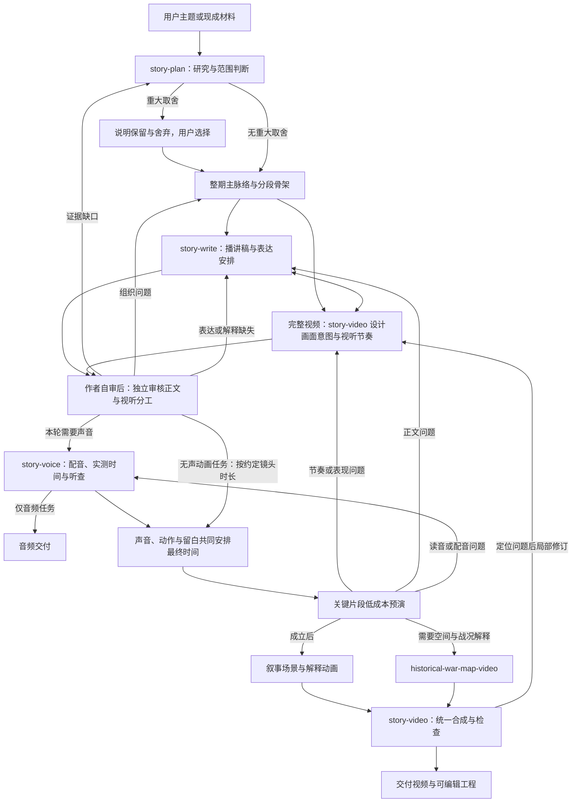

# 故事与动画 Skill 集合：快速成型计划

初版：2026-10-11。完善版：2026-10-12。当前状态：按[实施计划](./实施计划/README.md)建设中；具体完成范围以各实施包记录和实际文件为准。

本版将[计划审查与完善建议](./故事与动画Skill集合-计划审查与完善建议.md)中的问题纳入职责、流程、交接和验收。审查文档保留为修订依据，执行时以本计划为准。下面“实施计划拆分记录”是制定计划时的历史记录；后续用户已授权执行，当前实施状态见[实施计划入口](./实施计划/README.md)及各包记录，不能用旧记录判断是否已完成。

2026-10-12 内容层修订：[通用底座与创作专项改造计划](内容生成Skill-通用底座与创作专项改造计划.md)已获用户授权实施。用户实际观看后否定了影院、食店两个样片；当前改造和证据见第15节，第14节保留为历史。通用底座跟随具体主体的任务、行动、因果变化与结果，有真实阻力才展开应对；专项决定讲法，结构不规定开场、段数、反转或成长。历史审稿和技术运行证据不等于内容合格，不能概括为只差用户接受。

2026-10-12 后续方向：按用户要求持续提供样片，不提前定稿某种核心讲法、声音或画风。展示区现有[第一组动画画风、读法和生活观察](story-studio/examples/showcase/20261012-01/README.md)、[第二组尊界 V800 嘲讽切口](story-studio/examples/showcase/20261012-02/README.md)、[第三组活字印刷动作对照](story-studio/examples/showcase/20261012-03/README.md)和[第四组切洋葱三种视听表达](story-studio/examples/showcase/20261012-04/README.md)。X 制作分享只转译为可测试的动作因果、预演和镜头方法；保存原帖可见性限制，不把作者自述当作审美验证。专项与核心能力怎样沉淀，按[内容改造计划第17节](内容生成Skill-通用底座与创作专项改造计划.md#17-先用作品探索再沉淀-skill)跟踪。尚无用户选择；没有回复继续归档新批次，不计为认可。

### 实施计划拆分记录（2026-10-12）

本次目标：把本计划拆成可分别交给实施者执行的计划包，明确必须共同设计和联合验收的部分；本次交付为计划文档，不实施 Skills 或运行环境。

任务清单：核对旧内容/TTS/地图的关联 → 划定实施包和文件责任 → 写明各包步骤、输入输出与验收 → 核对依赖、链接和总计划覆盖范围。

本次验收：六个新 Skill 与战争专项均有唯一实施责任；每个包有前置条件、文件范围、具体步骤、交接与完成证据；开发依赖无环，内容与视听设计的联合检查有明确时点；文档链接有效。本次不验收配音、代码运行、动画效果或成片。

计划交付：[实施计划总入口](./实施计划/README.md)，包含00交接基础、01内容组、02配音组、03视频与战场适配、04总控与联合验收五个包。00之后可分别实施01、02和03A，完整视频的内容与视听设计在正式配音前共同核对；03B接入真实声音，04完成路由和完整一期验收。

本次结果：已完成包划分、文件责任、任务步骤、交接和验收说明；已核对技能覆盖、依赖顺序与本地文档链接。所有实施包仍未开始，本次仅交付计划。

## 1. 本轮决定与目标

建立一套可以分别调用、也可以连续生产的 Skills：从主题与材料开始，完成故事构思、播讲稿与视听设计、正文审核、配音、动画和完整视频。

稿件承担叙事推进：安排观众何时知道什么、怎样理解人物行动与结果。完整视频同时设计声音的语气、停顿与重点，以及画面的信息揭示、动作和留白；由统一的视听脚本把这些安排联系起来。只要求稿件或音频时，按对应范围交付。

用户明确决定：现有 investigation-video 作为内容生产的经验与参考来源；旧视频层不作为新架构基础。新视频路线采用 Remotion + React + SVG 代码动画，配合专门的历史战场 Skill。当前优先快速成型。

因此采用**新集合、新入口、一个动画运行环境**。从旧系统筛选内容规则和可用工具；不要求新系统依赖旧总控、旧视觉预设、旧镜头配置或旧工程格式。旧文件与已有工程保留，本计划不安排重写或迁移它们。

第一版定位为知识类口播动画：能讲人物、事件、历史过程和反直觉问题，能以动画解释行动、关系和结果。第一版不承诺电影级人物表演、连续打斗、自动生成所有历史美术或无人参与的质量保证。

## 2. 已核实的起点及实际缺口

| 起点 | 证据与当前状态 | 可以继承什么 | 不能据此认定什么 |
|---|---|---|---|
| 旧内容流程 | [Skill 入口](/Users/jack/Documents/codes/lvgou/ai-videoxxx/skills/investigation-video/SKILL.md)、[内容规则](/Users/jack/Documents/codes/lvgou/ai-videoxxx/skills/investigation-video/references/content-generation.md) | 材料索引、体量判断、mainNarrative、段落任务、写作回查、定位正文的审核方法 | 旧规则全部必要，或只要遵守就能稳定产出好内容 |
| 故事策划 | [story-planner](/Users/jack/Documents/codes/lvgou/ai-videoxxx/skills/story-planner/SKILL.md) | 材料优先、按内容组织、阶段可单独交付 | 与新策划 Skill 同时争夺生产入口 |
| 配音底层 | [tts.mjs](/Users/jack/Documents/codes/lvgou/ai-videoxxx/skills/investigation-video/scripts/tts.mjs)、[tts-s20.mjs](/Users/jack/Documents/codes/lvgou/ai-videoxxx/skills/investigation-video/scripts/tts-s20.mjs) | 火山接口、现有音色参数、缓存、真实时长和时间戳处理 | 旧入口可直接独立使用：它绑定旧规则路径、审核格式与日志 |
| 叙事动画试作 | 初版记录迁都样片；原相对位置 `work/animation-demo-20261011-xiaowen/index.jsx` 本轮未找到 | 保留技术思路；源码找回前不能安排直接复用 | 现存可复用源码、成熟角色动画系统或用户审美认可 |
| 战场能力 | [战争地图 Skill](/Users/jack/Documents/codes/lvgou/ai-videoxxx/map-demo/skills/historical-war-map-video/SKILL.md)、[地图工程说明](/Users/jack/Documents/codes/lvgou/ai-videoxxx/map-demo/README.md) | 地形、部署、路线、阵营与镜头的组织方法；SVG 和地形生成实现参考 | 日本演示数据适用于中国历史；虚构地形可以当真实战场；已完成完整播放验收 |

以上样片和工具状态沿用初版记录；2026-10-12 本轮只复核本地文档、依赖引用和目录位置，没有重新调用 TTS、渲染或联网核实。旧资料现位于 `ai-videoxxx`，当前 `ai-video` 是新集合的拟建项目。此前 18 秒样片的渲染与抽帧记录不能证明新集合、长视频、语音与战场混合编排已打通。

## 3. 第一版 Skill 分工

六个阶段入口、两个内容方法专项，加一个已有战争地图专项。专项方法按本期选用，阶段职责共用；不另拆研究、骨架审核、正文审核、字幕、混音和封面为独立 Skills。

| Skill | 独立调用时做什么 | 最小输入 | 交付 | 责任边界 |
|---|---|---|---|---|
| `story-produce` | 连续制作或从指定阶段恢复 | 本轮目标、停止位置、已有产物 | 产物链接与本期入口更新 | 路由、检查输入、记录有效版本与返回阶段；不重复定义写作和动画规则 |
| `story-plan` | 研究材料、构思故事、判断范围；需要时规划系列分集 | 主题或材料、受众、内容要求 | 来源索引、整期主脉络、分段骨架与预计体量 | 明确观众所得、重点与事实边界；重大聚焦/分期选择才询问 |
| `story-write` | 将骨架写成可播讲正文，或修改用户稿 | 骨架、来源、表达要求；完整视频还接收关键画面意图 | 有稳定句段 ID 的播讲稿、必要表达标注、作者自审 | 负责语言与事实表达；与 story-video 对齐关键段落，缺关键资料时回查 |
| `story-review` | 单独审构思、骨架或正文 | 待审内容、目标、来源；完整视频另附视听设计 | 定位缺陷、依据和通过/需修订结论 | 正文审核直接读正文；核对计划中的声音与画面分工，不把设计说明当作已实现效果 |
| `story-voice` | 将有效稿件与表达要求生成音频，或检查已有音频 | 稿件、审核依据或明确冻结决定、声音设置与必要表达标注 | 音频、实测时间、实际听查记录 | 按本期讲述意图核对可用声线与实际读法；默认参数仅作技术回退，修正具体错读、停顿和衔接问题 |
| `story-video` | 组织完整视频的视听设计、预演、动画与最终合成 | 骨架/正文、来源与视觉要求；最终合成需要实测音频时间 | 视听脚本阅读视图、分镜、可编辑工程、视频与检查记录 | 正文定稿前介入关键段落，负责声音与画面的整体安排；不擅自改口播事实或已确认范围 |
| `story-satire` | 对具体对象进行嘲讽评论的构思、写作或审查 | 当前要求、材料或已有稿 | 复用当前阶段产物，提供适用的创作判断 | 从材料关系选落点，不事后贴情绪；无第二正文或专项审核全链 |
| `story-history` | 历史人物、事件、生活和制度内容的构思、写作或审查 | 当前要求、史料或明确授权改编 | 复用当前阶段产物，提供历史叙事方法 | 按关注点组织，不固定战争、权谋、危机或升华；可与嘲讽方法组合 |
| `historical-war-map-video` | 单独制作有明确空间含义的战场镜头 | 年代、地形/位置/路线依据、事件顺序、画面时长 | 战场场景组件或约定规格的视频片段 | 只负责空间与战况表达；由 story-video 组装，普通叙事不必调用 |

独立使用不要求从头走流程。只有稿件时可以写作或审核；只要动画时可以提供文字和镜头时长，不强制先配音。有声片的发音时长来自真实音频，最终剪辑同时包含经设计的停顿、无旁白动作与读图留白，不能只以旁白长度决定全部画面。

| 起始输入 | 接入方式 | 完成边界 |
|---|---|---|
| 已有稿件 | 保留原文，补当前阶段必要的句段 ID；核对是待改稿、已核准稿还是用户明确冻结稿 | 不因缺内部骨架格式重走全部研究；新增事实或实质改写仍需来源与审核 |
| 已有音频 | 有可靠文本和时间则直接复用；缺失时按任务需要转写、对齐并核对关键句 | 无法可靠对齐时只交付可支持粒度的分镜；不得把估算称为逐字实测时间 |
| 已有分镜或场景 | 核对内容、资源、时长、帧率和场景入口，补接入必需信息 | 不要求改成完整内部工程；可只交付指定片段 |
| 仅主题或材料 | 从 story-plan 开始 | 以用户要求的停止阶段为边界 |

新制作调用新入口。旧 investigation-video、story-planner 作为实现参考保留，不能在每期生产时把新旧规则全文一起读取。

## 4. 整体流程和必要返回



图中展示完整生产及主要分支。只要骨架、稿件或审核结果时，在对应阶段交付；稿件任务不需要视觉环节。骨架可以单独审查，不新增每期必过的骨架审核门。新写或实质改写正文在正式配音前完成独立审核，预演也使用有效审核或冻结依据对应的文本。

发现盲区时只补能影响当前判断的材料，补完回到原段落；不重新研究整个主题。修改上游后标记受影响的下游产物过期，禁止用旧通过记录放行新稿。

### 4.1 视听脚本与时间安排

完整视频由 story-video 组织统一的视听脚本阅读视图，story-write 提供正文和必要的声音表达要求，story-voice 回填可执行性与实测结果。它由第10节的唯一数据源组合展示，不再手工维护一份重复正文或重复时间轴。

| 每个叙事单元需要看清什么 | 最小内容 |
|---|---|
| 内容推进 | 单元 ID、关联句段、观众在这一段新知道什么或感受到什么变化 |
| 口播与声音 | 实际正文；仅在有作用时标注语气、重点、停顿或速度变化；标注不进入朗读正文 |
| 画面与分镜 | 关联镜头、开始状态、发生的动作/信息变化、结束状态；说明与声音的配合 |
| 时间 | 配音前预计起止/时长并标“估算”；生成后显示音频实测时长和成片时间码（分:秒） |
| 关键同步与留白 | 必要时关联具体句子、词或动作完成点；记录无旁白段的作用与持续时间 |
| 依据 | 复用现有来源与素材引用，标明影响理解的示意或不确定细节 |

一个单元可以包含多句、多镜头，镜头也可跨句；按信息、行动或情绪的真实变化组织，不固定数量，不逐句强配镜头。正文、画面可互补，但不能用尚未实现的画面替审核者补出正文缺失的解释。仅靠画面承担的必要信息，应在设计和成片中分别核对是否可读、可理解。

时间分为三类：编辑预计时间用于控制体量；音频实测时间用于确定发音与字幕依据；最终剪辑时间用于安排音频片段、镜头和留白。最终成片时长取实际时间轴的终点。音频内已有停顿和剪辑新增留白分开记录，防止重复添加。用户明确的硬时限必须满足；估算偏差由内容与节奏判断是否调整。

当动作或读图需要更长时间，先判断能否提前铺垫、延续镜头或在句段边界留白；仍不成立时局部改表达并重配。不得无依据加速声音或压缩必要解释。关键同步优先引用句子/词的实测位置；缺逐字时间时不能声称达到逐词同步。

### 4.2 预演与必要返回

精细制作前，先用关键画面或粗动画预演最不确定的关键片段；有声任务配有效音频，无声任务按约定镜头时长，检查信息揭示、动作结果、画面阅读时间和声音配合。已预演成立且输入未变的片段可直接细化，不为每段增设审核门。预演只证明已看到的粗节奏，不替代成片连续播放。

| 发现的问题 | 返回位置 | 更新边界 |
|---|---|---|
| 事实依据不足或主线变化 | story-plan → story-write → story-review | 更新受影响来源、骨架与正文，再判断下游失效范围 |
| 句子难听懂、信息顺序或必要解释不成立 | story-write → story-review | 核准新正文后重配受影响片段并重排后续时间 |
| 错读、异常停顿、声音衔接或表达执行失真 | story-voice | 正文不变时修发音/声音参数并重听；改正文则返回正文审核 |
| 镜头节奏、读图时间或动作无法成立 | story-video，必要时协同 story-write / story-voice | 优先局部重排；需要改声音时明确涉及的句段，不把复用音频当成硬限制 |
| 角色识别、资源、构图或动画实现错误 | story-video 或战场专项 | 修受影响场景；未改变音频和剪辑时间时复用声音与时间信息 |

## 5. 内容能力与旧经验的取舍

材料、来源和运行经验可复用；旧项目的讲解身份、空泛设问、延迟态度及讲完再总结意义，不作为新内容风格继承。按当前用户要求，共同构思先有一件具体的事：主体在做什么、遇到什么情况、怎样行动、局面怎样改变、落到什么结果。真实阻力有材料才用，平静过程沿实际步骤和状态展开。它检查推进关系，不能变成五段格式，也不能造危机或成长。

| 保留的方法 | 新集合中的位置 | 简化与边界 |
|---|---|---|
| 可靠材料、来源位置、重要边界 | story-plan 的材料记录 | 总览加按需拆分的来源正文，不重复建立知识库与来源台账 |
| 初研后判断内容体量 | story-plan | 只有明显改变主内容、方向或分期才询问；几分钟到十几分钟是参考，不是强制裁切 |
| mainNarrative 与分段作用 | story-plan → story-write | 说明本期内容连起来如何成立，评论、事件、机制与场景可采用不同组织；写作可检验并同步修正骨架 |
| 必要关系、解释和实际表达 | story-write | 按本期目的判断省略是否造成误解；不强迫所有题材填充同一套条件、代价和结果 |
| 根据任务与材料选择方法 | 通用判断 + story-satire / story-history | 当前要求优先；专项从构思参与，允许混合或缺席，不固定提问、反转或结尾 |
| 实际文本审核 | story-review | 先读用户要求与正文，再读作者构思和来源；核对任务、依据与表达成立，不增加评分或专项审核轮 |
| 用户样本库 | 集合参考目录 | 只有用户选入的内容才是优秀参考；生成记录、日志、测试片不自动晋升为范文 |

不把旧审核 JSON 的全部字段和周期机制当作新需求。新审核至少绑定实际稿件、骨架、要求、使用的来源及审核规则版本，记录具体缺陷位置；程序只检查版本和交接，不宣称能自动判断故事好不好。用户明确冻结外部稿件时记录实际决定，不伪造 AI 审核。

故事策划支持历史事实叙述和用户明确要求的虚构创作；历史任务不补造人物心理和动机。系列策划先用一份系列 Markdown 记录系列承诺、分集边界、已讲背景与待讲内容，不先开发排期系统或跨期数据库。

### 播讲表达与独立审核

写稿时检查听者能否跟上：主体和指代是否明确，陌生名词是否有必要的解释，信息进入顺序是否符合当前理解需要，长句是否难以听清，段落之间是否有可理解的连接。只展开本期理解所需的关系、原因与后果；具体表达可服务行动、评论、感受、铺垫和回味，不以固定句长、问句比例或情绪标签数量代替判断。

必要的语气、重点和停顿随稿件一起设计，以具体表达作用为依据；先明确谁在怎样讲这件事，再核对可用声线和表演输入，默认参数只是技术回退。口播ID可以包含几句承接的话，按一次说话动作组织，避免逐个句号切断声音。不要求每句加标注，不把原速理解为所有段落必须以相同节奏平读。

作者先直接检查正文并修正问题。独立审核者先对照可信的当前要求读实际正文，再看骨架、作者解释、适用方法与原文，不能接受作者中心后替正文补出其效果。完整视频附必要视听设计；独立调用明确对象，骨架通过不能放行正文配音。新本期以 requirements 保存必要原话与有效更改，作者选择另记，运行状态在 episode 维护。

审核至少检查事实依据、主线与承诺兑现、关键解释、播讲清晰度和无作用的重复；完整视频另检查声画分工有无必要信息缺口与误导。缺陷定位到实际句段和依据，修订后复核受影响项；中心或范围变化才扩大复核。未解决的实质问题不能放行，观点不同或个人表达口味不自动算缺陷。

用户明确冻结的外部稿、未修改且有有效审核依据的旧稿可记录其真实依据；纯视觉修改不重审正文。冻结不代表 AI 审核通过，也不豁免音频、视觉和成片的实际检查。需要独立审核但当前环境无法执行时，保留稿件并明确该阶段未完成，不以作者复审冒充。

### 配音的实现与检查

story-voice 接收稿件及必要表达标注，核对 TTS 能执行的参数与控制方式。无法执行的表演要求先回到视听设计调整，不能只把文字指令写入文件就报告实现。试片先验证关键表达与句间衔接，避免全文生成后才发现能力不匹配。

生成后实际听查错读、吞字、异常停顿、句间音色或情绪断裂、重点失真；结合声文对应和实际时间记录问题位置。技术校验不能替代听查，也不能把文本模拟听感当成真实收听。首条完整作品检查完整音轨，后续修改复听受影响片段及衔接处；最终成片再检查声画配合。无可用听查能力时明确记录未听查，不宣称配音表现已通过。

专业检查处理可定位问题，用户是否喜欢声线与表现单独记录；不把主观接受作为每一步等待审批的条件。纯声音参数或发音映射的修正保留正文，重新生成与听查相关片段；改变实际措辞则重新审核。

## 6. 新视频层的具体方向

**主技术固定为 Remotion + React + SVG。** 一期按内容需要组合叙事场景、关系/机制图解和战场动画。第一版不再接入旧 ConfiguredVideo、旧 video-presets 或旧镜头类型登记体系。

每个场景是一个可独立渲染的 React 组件，接收实际片段时长、需要表达的内容和必要视觉参数。动画按帧号计算，不依赖真实时钟、随机运行顺序或 CSS 自播放。官方也要求以 useCurrentFrame 驱动动画，以避免渲染中的闪烁与不确定性。[Remotion 动画说明](https://www.remotion.dev/docs/animating-properties)

| 画面任务 | 第一版表现 | 验收重点 |
|---|---|---|
| 人物做出选择、传令、出发、会见、物资转移 | 分层人物、道具、场景与镜头；简单关节动作/姿态切换 | 观众能识别谁做了什么、前后发生什么变化；不能只有整张图平移 |
| 势力关系、制度变化、人物分歧 | 关系线、位置变化、关键物件和少量文字 | 画面使关系更清楚，不能用一屏文字替代解释 |
| 战争推进、地形限制、部署与撤退 | 战争地图 Skill 的大/小地图表现 | 地形与路线有依据，军团与轨迹一致，结果能看懂 |
| 段落连接与时间推进 | 镜头切换、场景延续、必要的时间标识 | 保留人物和地点识别线索，避免每句重置场景 |

初版迁都样片的技术思路可参考，源码本轮未找到；不能把车队、城门、红日、雪山和同一种人物自动复用到每个历史题材。浮世绘也是可选视觉参考；中国历史的服饰、建筑、道具和地理不因画风选择而变成日本元素。

分镜用一句话写清“这个镜头开始是什么状态、发生什么、最后变成什么”，再列涉及的旁白段落、素材/史实依据与时长。比如稿件说进入城门，画面就要明确出现进入后的状态；只把车队移到门前不能视为完成。示意动作与真实历史动作的证据要求分开。

为快速成型，首片先建立确实会重复使用的少量角色、场景和动作组件。不要先做人物生成器、万能场景 schema、自动编剧引擎或大规模动作库。角色表情、复杂动作确实超出代码图形能力时，再用用户选定的图像素材/生成分层图补足。

每期在 `visual/` 保存一份简短的视觉参考，确定实际出现的角色识别线索、阵营颜色、地图标记和必要的空间关系；共用资产复用同一份。镜头说明承接前镜的哪些状态，避免角色外形、行进方向和地点关系无故改变。只约束影响辨认和理解的项目，不预建庞大美术规范。

画面也要遵守事实边界。影响结论的路线、部署、人数、动作与位置需关联依据；没有精确依据时采用说明性布局，不画出未经证实的精确坐标、疆界或动作细节。必要时在画面标明示意。一般装饰不要求逐一史料证明，但不得造成时代、人物或事件误导。

故事场景与战场场景的接口在首片中以实际需要确定：局部帧、时长、画幅、资源入口和来源说明。最终合成负责统一音轨与字幕，专项片段若自带声音须明确保留或移除，避免重复旁白。

## 7. 技术与工具清单

“首版使用”是规划决定；“已有”不等于新集合中已验证。

| 技术/工具 | 用途 | 当前证据/入口 | 第一版决定 |
|---|---|---|---|
| Codex 与 Markdown Skills | 执行各阶段、按需读取规则 | 当前工作环境 | 主任务顺序组织生产；新写或实质修改的 AI 正文由独立上下文审查，适用条件见第5节；不建多代理调度系统 |
| AnySearch | 定向搜集史料与官方资料 | [本地 Skill](/Users/jack/.agents/skills/anysearch/SKILL.md)；初版记录 batch_search 成功 | 默认检索工具；备用网页搜索沿用用户已有授权 |
| Node.js | 脚本、TTS、渲染入口 | 旧工程要求 ≥20.12；此前本机为 24.11.1 | 使用本机已配置运行时，实施时检查实际版本 |
| Remotion 4.0.508 + React 19.2.8 | 场景、逐帧动画、时间线与 MP4 渲染 | [现有 package.json](/Users/jack/Documents/codes/lvgou/ai-videoxxx/skills/investigation-video/template/remotion/package.json) | 新运行环境沿用这组可用版本；不为获取新功能先升级 |
| SVG / JSX | 人物、道具、路径、地图与关系图 | 迁都样片源码本轮未找到；[地图组件](/Users/jack/Documents/codes/lvgou/ai-videoxxx/map-demo/index-v2.jsx) | 主绘制方式；普通场景直接写组件 |
| Chromium | Remotion 帧渲染 | 此前使用本机 Playwright Chromium 缓存 | 提供可配置 browserExecutable；不硬编码个人缓存路径、不自动下载 |
| FFmpeg / ffprobe | 音轨处理、合成辅助、抽帧、格式与时长检查 | 本机已有，样片曾实际使用 | 首版使用；抽帧不代替连续动作检查 |
| 火山/豆包 TTS | 中文旁白与时间戳 | [tts.mjs](/Users/jack/Documents/codes/lvgou/ai-videoxxx/skills/investigation-video/scripts/tts.mjs) | 迁出必要底层及缓存依赖；保留渊博小叔与原速，不同时试新声线 |
| Python + Pillow/numpy | 战场地形图片与图像辅助 | [地形脚本](/Users/jack/Documents/codes/lvgou/ai-videoxxx/map-demo/build-terrain.py) | 仅相关任务使用；当前虚构地形不能用于正式地理结论 |
| GeoJSON 与有来源的历史地图/地形数据 | 战场空间依据 | [地图数据入口](/Users/jack/Documents/codes/lvgou/ai-videoxxx/map-demo/map-data.mjs) | 逐题核实；现代行政边界不得当古代疆界 |
| yt-dlp | 下载明确给出的视频来源 | [下载脚本](/Users/jack/Documents/codes/lvgou/ai-videoxxx/skills/investigation-video/scripts/download-source.mjs) | 研究参考时按需复用，不作为新视频视觉素材主线；平台可用性逐次验证 |
| 豆包 ASR / 可选本地 Whisper | 参考视频转写 | [转写工具说明](/Users/jack/Documents/codes/lvgou/ai-videoxxx/tools/extract-audio-content/README.md) | 按需，正式 TTS 有有效时间戳时不重复 ASR |
| imagegen | 复杂角色、背景和分层素材 | [本地 Skill](/Users/jack/.codex/skills/.system/imagegen/SKILL.md) | 可选，不成为第一条纯代码样片的必需服务 |
| Git、文件摘要 | 代码维护、内容版本与失效检查 | 现有仓库和 Node crypto | 使用已有能力，不加数据库或向量系统 |

当前 `tts.mjs` 直接引用 [content-cache.mjs](/Users/jack/Documents/codes/lvgou/ai-videoxxx/skills/investigation-video/scripts/lib/content-cache.mjs)，并使用 Node 内置模块及 FFmpeg/ffprobe。初版列出的 `scripts/lib/runtime.mjs` 本轮未找到，不再将它列为已存在依赖。实施时沿当前代码的实际导入与外部命令核对迁入范围；`tts-s20.mjs` 的旧审核、日志和 opening 约束需适配新交接，不能整段复制或直接绕过。

## 8. 可参考或纳入的 Skill 登记表（含链接）

本地链接已检查文件存在；外部链接沿用初版调研记录，不表示本轮重新核实、已安装或已运行。这里是选型登记，不是每期必读清单。

| Skill / 项目 | 对应环节 | 借鉴或使用方式 | 第一版取舍 | 可点击入口与证据状态 |
|---|---|---|---|---|
| investigation-video | 内容全流程经验 | 抽取主脉络、材料回查、正文审核的有效要求 | 参考；旧视频层不接入 | [本地 Skill](/Users/jack/Documents/codes/lvgou/ai-videoxxx/skills/investigation-video/SKILL.md)，初版记录已核对 |
| story-planner | 研究与故事构思 | 材料优先、结构与交付范围 | 参考到新 story-plan，避免双入口并用 | [本地 Skill](/Users/jack/Documents/codes/lvgou/ai-videoxxx/skills/story-planner/SKILL.md)，初版记录已读取 |
| historical-war-map-video | 战场专项 | 地形、军团、路线、战略/战术切换 | 纳入，适配新镜头接口 | [本地 Skill](/Users/jack/Documents/codes/lvgou/ai-videoxxx/map-demo/skills/historical-war-map-video/SKILL.md)，初版记录已读取 |
| Remotion 官方 Skills | 动画实现与渲染 | markup/render/captions/maps 等按任务读取 | 优先选入的外部技术参考；安装属于实施阶段 | [官方仓库](https://github.com/remotion-dev/skills)、[官方说明](https://www.remotion.dev/docs/ai/skills)，初版记录已核实；具体规则需匹配本地版本 |
| huashu-art-motion | 画面设计与动作组织 | 风格配方、先定关键帧、再组织场景动作 | 借鉴方法，不整套替换主引擎、不把运动量门禁当审美标准 | [官方仓库](https://github.com/alchaincyf/huashu-art-motion)，初版记录已查阅；未安装验证 |
| narrative-core | 用户参考视频的分析 | 提取可迁移的叙事机制，避免固化案例桥段 | 分析用户样本时可选 | [本地 Skill](/Users/jack/.agents/skills/narrative-core/SKILL.md)，入口存在，本轮未审计效果 |
| novel-distill | 人物与事件材料梳理 | 从有依据的材料提取行动、约束和结果 | 复杂事件按需用，不强制每期调用 | [本地 Skill](/Users/jack/.codex/skills/novel-distill/SKILL.md)，入口存在，需按历史事实任务约束使用 |
| dbs-good-question | 模糊任务澄清 | 将模糊需求变成可研究的具体任务 | 仅输入不清时用；不把问题模板写进口播 | [本地 Skill](/Users/jack/.codex/skills/dbs-good-question/SKILL.md)，入口存在，本轮未运行 |
| imagegen | 美术资产 | 生成背景、角色姿态、透明素材，代码组织动作 | 按需补充 | [本地 Skill](/Users/jack/.codex/skills/.system/imagegen/SKILL.md)，可用能力，本轮未生成 |
| HyperFrames | HTML 动画的另一条实现路线 | 参考其路由与按需加载方式 | 暂不引入第二套主渲染器 | [官方仓库](https://github.com/heygen-com/hyperframes)，初版记录已核实支持 HTML/CSS 到确定性 MP4 |
| Hypit | 更大范围的媒体制作编排 | 参考脚本、素材和组合的责任划分 | 暂不纳入主链，避免再接一套运行体系 | [本地 Skill](/Users/jack/.codex/skills/hypit/SKILL.md)，此前读取，当前样片未使用 |
| video-use | 已有录制素材的剪辑 | 将来有大量口播/采访素材时再评估 | 当前纯动画主线不必加入 | [本地 Skill](/Users/jack/.codex/skills/video-use/SKILL.md)，入口存在，非本轮运行验证 |
| manim-video | 数理与技术图解 | 数学/科学题材可单独输出片段 | 历史首版暂缓 | [本地 Skill](/Users/jack/.codex/skills/video-use/skills/manim-video/SKILL.md)，入口存在，非本轮效果验证 |
| writing-prompt | 集合设计与维护 | 条件、操作、输出、失败去向及按需读取 | 设计阶段使用，不是每期生产前置 | [本地 Skill](/Users/jack/.agents/skills/writing-prompt/SKILL.md)，初版记录已读取 |
| rethink / brainstorming | 方案讨论 | 检查假设和画面方向 | 用户需要构思时使用，不叠加为每期固定门槛 | [rethink](/Users/jack/.agents/skills/rethink/SKILL.md)、[brainstorming](/Users/jack/.codex/skills/brainstorming/SKILL.md)，初版记录已读取 |

官方 Remotion 仓库已按创建、动画标记、渲染、地图、字幕等划分参考入口；可以借鉴按需加载，不需要每个入口再包装成自己的 Skill。Huashu 提供独立的风格/解说动画方法及工具链，接入代码前需逐项适配，不能假定它的组件能直接导入 React 工程。

外部样片只作为研究参考，不自动加入用户的优秀样本库。复制第三方代码或素材时保留相应许可；例如 Huashu 的作者角色资产不随代码的 MIT 许可开放使用。

## 9. 额外技术调研与头脑风暴取舍

| 技术与链接 | 官方说明能支持什么 | 对当前任务的价值 | 当前决定 |
|---|---|---|---|
| [Motion Canvas](https://motioncanvas.io/) | TypeScript 动画及网页编辑器，辅助与音频对齐 | 可参考按事件组织连续动画、按音频安排动作的方法 | 保留参考；首版使用它会增加第二套动画执行模型 |
| [Theatre.js](https://www.theatrejs.com/) | 浏览器中的关键帧、曲线编辑和 JS 动画变量控制 | 用户将来需要直接拖动调整镜头与动作时有价值 | 暂缓，当前先解决 Agent 能生成可看的片段 |
| [HyperFrames](https://github.com/heygen-com/hyperframes) | HTML、CSS、媒体与可定位动画渲染为 MP4，并提供 Agent Skills | 是完整替代路线，可比较开发方式 | 不与 Remotion 同时建设主链，避免工具数量代替产出 |

调研后的优先级：Remotion 官方规则 → 本地战场专项 → Huashu 的画面方法 → 必要时 imagegen。没有发现必须立即再加一种渲染技术才能完成第一版的证据。

最快改善视觉的方法是先做一段有真实动作结果的代表性场景，再把其中可复用的代码整理出来。增加风格数量、换渲染器、提高运动量，都不能单独证明动画更好。

## 10. 目录与最小交接

建议新集合根目录：`/Users/jack/Documents/codes/lvgou/ai-video/story-studio/`。这是拟建位置，本轮未创建。

```text
story-studio/
├── README.md                     集合地图、入口与命令
├── skills/
│   ├── story-produce/SKILL.md
│   ├── story-plan/SKILL.md
│   ├── story-write/SKILL.md
│   ├── story-review/SKILL.md
│   ├── story-voice/SKILL.md
│   └── story-video/SKILL.md
├── references/
│   └── handoff.md                共享交接规则只定义一次
├── runtime/
│   ├── voice/                    TTS、缓存与时间信息
│   └── remotion/                 同一引擎、动画与地图组件、总片入口
└── samples/                      仅用户选入的参考；不预置生成记录
```

战争 Skill 首版明确引用现有绝对路径，以本期新地图数据和新 runtime 入口工作，不默认执行旧 map-demo/render.sh。待有实际维护需要再迁移它，避免同时出现两个同名规则源。

各新 Skill 在本机技能目录分别建立链接到真实目录，不假定扫描器自动识别嵌套子目录。运行代码安装于集合中一处，单独调用某个 Skill 时也能定位这处运行环境。

一期工程采用以下简单约定；只创建当前任务实际需要的部分：

```text
<episode>/
├── episode.md          当前目标、有效版本、停止阶段、下一步与阻碍
├── research/           来源索引和必要原文
├── outline.md          mainNarrative、段落任务、必要解释与预计体量
├── script.md           唯一正文、稳定句段 ID、必要的声音表达标注
├── review.json         审核对象、结论、问题位置与输入摘要
├── audio/              音频片段、timing.json、缓存引用与听查记录
├── visual/
│   ├── shots.json      叙事单元、分镜意图、音频放置与最终剪辑时间
│   ├── direction.md    本期必要的角色、风格与空间连续性参考
│   ├── scenes/         本期 JSX 场景
│   └── assets/         素材、地图数据及来源说明
└── output/             视听脚本阅读视图、预演、成片与交付记录
```

### 10.1 唯一来源与最小字段

| 文件/产物 | 最小职责与内容 | 更新方 |
|---|---|---|
| `script.md` | 实际口播正文与稳定句段 ID；必要表达标注放独立标记区，不混入朗读文本 | story-write；story-voice 可反馈，但不静默改正文 |
| `timing.json` | 关联稿件与声音设置摘要、实际音频文件及指纹；各句段在源音频中的起止秒数，有可靠逐字时间则保留；缺失项如实记录 | story-voice；外部音频对齐也记录实际方法与粒度 |
| `shots.json` | 叙事单元引用句段与镜头；镜头记录意图、状态变化、场景入口、资源和来源，以及最终起始帧与帧数；声音放置记录所用源音频区间及成片起点；必要同步点与有作用的留白单独明确 | story-video；正文和源音频时间只引用，不复制修改 |
| 视听脚本阅读视图 | 组合正文、表达标注、分镜与时间，展示“分:秒—说什么—怎么说—画面发生什么”；显示源文件摘要与时间状态 | 从上述文件生成，源文件变化后重新生成；不作为另一个编辑真源 |
| `review.json` | 待审对象类型、实际结论、问题位置、稿件/骨架/要求/实际来源/审核规则摘要；完整视频另绑定影响内容理解的视听设计依据 | story-review；用户冻结决定按真实类型记录 |

`shots.json` 中的叙事单元和音频放置可用最小列表表达，不建通用场景 DSL。配音前使用明确标为估算的时间，场景入口可待定；渲染前必须有完整场景、资源和最终时间。阅读视图不需要首版做专门编辑器。

### 10.2 时间映射与渲染边界

- 源音频时间和成片时间分开。声音放置明确音频入点、出点及成片起点，避免在源时间戳上直接加减留白。第一版默认原速播放；字幕按同一映射换算到成片时间，不另维护一条手工时间轴。
- 正式有声片默认 30fps、16:9，预览 720p，正式导出按本期要求。采用统一 `round(seconds × fps)` 边界换算，相邻镜头共享边界，避免逐段取整累加误差。
- 音频已有停顿计入源区间；额外留白计入剪辑。镜头覆盖最终成片时间，声音允许有设计过的空白；尾音、动作完成、必要读图停留均须保留。
- 场景组件按局部帧运行；最终组合负责全片偏移、字幕、音轨和总时长。优先复用场景组件；接入独立 MP4 时核对帧率、分辨率、时长与音轨。
- 关键同步点从可靠实测位置换算；只有句段时间时按该精度组织，不补造逐字数据。缺少满足镜头需求的精度时先补对齐或调整设计。

### 10.3 修改与恢复

| 变化 | 必须更新/检查 | 可复用内容 |
|---|---|---|
| 正文、主要范围或关键事实变化 | 受影响正文审核、配音、时间映射、字幕与镜头；主要范围变化同时修骨架 | 输入未变的音频片段和无关场景 |
| 声音设置、表达标注或发音映射变化 | 相关音频缓存身份、实测时间和听查；时长变化时重排时间轴及同步点 | 正文未改则保留正文审核，前提是没有改变语义或事实表达 |
| 增减留白、调整镜头或音频放置 | 剪辑时间、字幕映射和受影响同步点 | 源音频与源时间戳 |
| 仅构图、角色资源或动画实现变化 | 对应场景、连续性和视觉事实检查；承载必要信息的视觉内容变化时复核声画分工 | 语义与声音未变时保留正文审核、配音 |
| 来源或规则变化 | 判断影响到哪些主张、设计和审核依据，受影响项重新核对 | 已核实不受影响的产物，不盲目全片重做 |

正文摘要与表达标注摘要分开记录；只改声音标注且未改语义时可沿用正文审核，实际声音输入仍需更新缓存与时间依据。episode.md 指向当前有效文件；旧产物可保留但不得误作最新版本。第一版按实际文件与片段摘要判断失效，不开发通用依赖图引擎。TTS 缓存身份覆盖实际文本、声线、声音参数、有效表达控制和发音处理；不能只按文件名复用。

### 10.4 运行依赖的落地范围

旧 `ai-videoxxx` 内容用于阅读参考与选取必要实现；新 voice/runtime 的运行依赖须迁入并核对闭包，不运行旧总控。战争 Skill 首版仍引用其现有入口，因此此文档依赖需在新 README 明示；新场景和数据使用新 runtime，不隐式调用旧演示工程。

实施时核对 Node、FFmpeg/ffprobe、Chromium、字体、TTS 配置和所需资源的实际位置与可用性。浏览器与外部工具路径通过明确配置传入，敏感参数走环境配置且不写入交付文档。缺依赖给出具体缺项，不自动下载浏览器或以个人缓存路径硬编码替代配置。新增依赖、运行检查和制作调用遵循当次授权及项目规则；本计划中的验收方法不等于本轮已执行或已授权全部命令。

## 11. 按依赖排序的实施计划

以下新路径相对拟建的 story-studio/。每步用一个代表任务推进，接口以该任务的真实需要为准。

| 顺序 | 工作与具体做法 | 文件/依赖 | 可检查的交付与验收 | 成本与可能负收益 |
|---|---|---|---|---|
| 1 | 核对旧参考与依赖；建立六个入口和最小交接规则，明确各阶段停止位置与独立输入 | `README.md`、`references/handoff.md`、`skills/*/SKILL.md` | 现成稿只审稿、已有音频接画面、只要骨架即停止；缺输入有具体处理方式 | 先写可用入口，不一次扩写全部候选工具规则 |
| 2 | 用真实材料完成主脉络、播讲稿和关键视听设计；明确语气、画面作用、预计时间及留白；完成作者自审与独立审核 | story-plan/write/review/video；本期 `outline.md`、`script.md`、初始 `shots.json` | 能读到统一视听脚本；正文关键缺口可被定位，不能靠骨架或画面说明补过 | 必要协作有成本；不强制逐句镜头、固定情绪或额外审核层级 |
| 3 | 迁入 TTS 必要依赖、缓存与时间能力；先生成有效稿中最需要验证的声音片段并听查 | `runtime/voice/`、story-voice、`timing.json` | 有真实音频和时间；表达是否执行有听查记录；旧审核不能放行改稿，声音变化不会误命中缓存 | 控制试配范围；不把文本标注或接口成功当成表现成功 |
| 4 | 建立单一 Remotion 环境、最小总片入口和时间映射；用关键画面/粗动画配声音预演 | `runtime/remotion/`、story-video、阅读视图生成能力 | 在明确浏览器与字体来源下生成预演；检查声音、动作、留白、字幕映射及最难的同步点 | 预演保持低成本；不为粗片先完成全部美术和组件库 |
| 5 | 预演成立后细化一个故事场景和一个有依据的战场场景；统一角色、阵营与空间参考 | 本期 `visual/`、战争 Skill | 动作有结果、军团与路线可理解、前后识别一致；视觉主张和示意边界可追溯 | 按本期必要细节制作；不拿旧虚构地图冒充真实地形 |
| 6 | 完成短链路成片与实际检查，再按问题局部返回 | 音频、时间、镜头、字幕和输出 | 约60–90秒作为初次试片预算，覆盖故事动画、地图、旁白与必要留白；实际听查和连续播放，定位问题时间码 | 时长仅是试片预算，不成为生产硬规则；复核集中在改动及其衔接 |
| 7 | 用用户确定范围的一期完整内容检查长片组织、节奏和局部更新 | 独立本期工程；同一 runtime | 交付完整视频；检验改稿、只改表达、只改构图三种更新范围，记录实际耗时与重复生成情况 | 短片成功不代表长片成立；不先承诺人天、成功率或全自动质量 |
| 8 | 仅整理实际复用组件，完善入口与依赖说明，建立 Skill 链接 | README、Skills、runtime | 独立调用、串联调用和恢复任务都能定位同一套有效产物；标清已验证能力与缺口 | 不追加第二引擎、自动发布、历史迁移或资产平台 |

实施主线为：最小入口 → 真实材料与视听设计 → 关键配音 → 低成本预演 → 场景细化 → 短成片 → 完整一期。每步暴露的问题返回实际责任阶段；不以先写完全部文档或搜全候选工具作为前置。

## 12. 快速成型的限制与完成标准

第一版先做：来源与主脉络、播讲稿与必要表达、统一视听设计、独立正文审核、实际配音、少量叙事场景、按需战场、字幕与成片。配乐和音效按内容需要安排；使用时检查是否遮盖旁白，不强制为首片增加独立声音制作系统。

暂缓：自动搜集优秀样本、历史工程迁移、旧视觉兼容、大规模多画风、3D 战场、自动口型、复杂骨骼、第二渲染器、知识库产品、评分系统、自动发布和跨平台运营后台。

| 完成条件 | 所需证据 | 不能替代它的证据 |
|---|---|---|
| 各 Skill 可独立使用、按要求停止或恢复 | 对应入口实际处理齐备输入或明确缺项，能定位当前产物 | 只有名称、路由图或目录 |
| 新集合可独立运行 | voice 与视频运行不依赖旧总控/旧配置；明确保留的战争 Skill 文档依赖 | 复制入口、旧环境曾运行成功 |
| 内容与视听设计成立 | 主脉络、正文、来源可核对；审核定位实际缺口；能看到文字、声音意图、分镜和时间的对应 | 作者自评、骨架完整、视听表字段齐全 |
| 配音与时间可信 | 实际音频、可靠时间粒度与听查记录；语气和停顿执行结果可检查 | TTS 请求成功、音频时长非零、文本模拟听感 |
| 故事动画与地图能共同叙事 | 动作完成、信息推进、角色/空间连续；必要视觉主张有依据；关键声画同步成立 | 静态关键帧、组件可编译、只有整体平移 |
| 完整视频可交付 | 实际 MP4；检查末句、尾音、字幕可读性、留白、黑帧/意外静音及整体节奏；记录连续播放观察 | 抽帧或程序格式检查单独通过 |
| 局部修改能够正确更新 | 实际改动后相关审核/音频/字幕/镜头更新，未变内容可复用 | 仅写了失效规则 |

交付时分别报告程序检查、实际听查、抽帧、连续画面检查和用户主观判断的状态。缺少某项实际能力或检查时记录具体缺口，不能宣称整条生产链已验收；用户主观判断尚无反馈时如实标记，不据此虚构认可或例行增加审批。

尚未验证：新 Skills 的调用稳定性、迁出 TTS 的表现控制、源音频到成片的时间映射、长片成本、真实历史地图数据获取、角色美术质量、连续动画观感、混合成片与用户接受程度。最先消除的不确定性是代表片段中播讲、动作与留白能否共同实现叙事意图，之后才判断完整一期的节奏与成本。

## 13. 本轮调研范围与取舍依据

初版记录通过 AnySearch、官方仓库/网站和 Context7 调研相关方向。第7—9节的外部工具信息保留为选型参考，不代表本轮重新验证；实施接入时核对实际版本、许可和可用性。

本轮完善依据是原计划、审查表和本地旧 Skill 规则；仅更新计划文档，未安装外部 Skill、未更新依赖、未实施新工作流、未运行生产或测试。

选择 Remotion 沿用初版的依赖与样片经验；本轮能定位战场组件，但未找到迁都样片源码，因此首个新叙事片段需实际制作验证，不能以旧记录代替。选择新集合的依据是用户已明确旧系统只作经验参考、旧视频层不用。把审核合成一个 Skill、视频导演与合成放在一个 Skill，是为了减少第一版交接；当真实维护压力出现时再拆。

需要特别避免：为了降低上下文压力而丢掉关键材料；为了“完整架构”增加每期必读文件；为了快速出片把示意历史细节说成已核实；把外部项目 README 宣称的能力当成在本机已验证。
